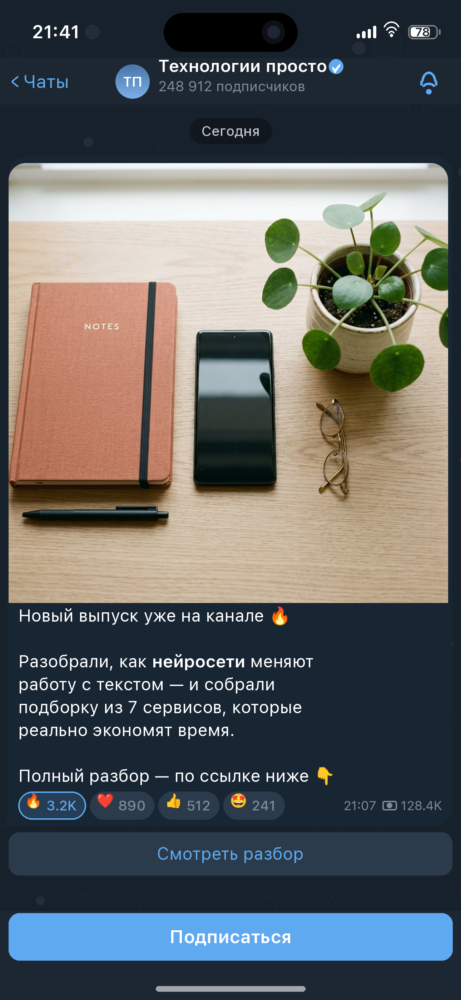

# tg-ios-mockup

Генератор аккуратных скриншотов постов Telegram-канала в стиле iOS (iPhone).
Одной строкой меняются **время поста**, **реакции** и **время на телефоне** —
плюс текст с разметкой, картинка, просмотры, канал, кнопки, тема и модель телефона.



* Python + Pillow: рендер без браузера и внешних сервисов, цветные эмодзи офлайн.
* Два режима: **веб-редактор** с живым превью (`python app.py`) и **консоль** (`python -m tg_mock`).
* Шрифт SF Pro и Noto Color Emoji лежат в `assets/fonts/`.

---

## Быстрый старт

### Веб-редактор (рекомендуется)

```bash
git clone https://github.com/sasuke22233/tg-ios-mockup.git
cd tg-ios-mockup
pip install -r requirements.txt
python app.py                # -> http://localhost:5000
```

Windows: `start_web.bat`, Linux/macOS: `./start_web.sh` (ставят зависимости и запускают).

Слева — все настройки, справа — живое превью (~0,3 с после правки). Кнопки:
«⬇ Скачать PNG», «⬇ Скачать config.json», пресеты в шапке
(«По умолчанию», «Тёмный + фото», «Светлый текст»). Картинки поста и аватара
загружаются файлами и складываются в `uploads/`.

HTTP-API: `POST /api/render` → `{token, preview, download}`,
`GET /preview/<token>.png`, `GET /download/<token>.png`,
`GET /download-config/<token>.json`, `POST /api/upload`.

### Консоль

```bash
python -m tg_mock --init                 # создать config.json по умолчанию
python -m tg_mock                        # -> output/post.png (1290×2796, iPhone 15 Pro)

python -m tg_mock --set post.time=21:07           # время поста
python -m tg_mock --set status.time=23:15         # время на телефоне
python -m tg_mock --set post.views=128400         # просмотры
python -m tg_mock --set 'post.reactions=[{"emoji":"🔥","count":3214,"selected":true}]'
python -m tg_mock --theme light --scale 2 -o out.png
python -m tg_mock --list-devices
```

---

## Что и где менять

| Что меняем | Ключ в `config.json` | В веб-редакторе |
|---|---|---|
| Время поста | `post.time` | «Пост» → «Время поста» |
| Реакции | `post.reactions[]` (`emoji`, `count`, `selected`) | блок «Реакции» + быстрый набор эмодзи |
| Время на телефоне | `status.time` | «Время на телефоне и статус-бар» |
| Просмотры | `post.views`, `post.views_format` | «Просмотры» |
| Текст поста | `post.text` | «Текст поста» |
| Картинка в посте | `post.media` (путь к файлу) | загрузка файла |
| Дата-плашка | `post.date_chip` | «Заголовок-дата» |
| Канал | `channel.name`, `channel.subscribers`, `channel.avatar`, `channel.verified` | блок «Канал» |
| Заряд, Wi-Fi, сигнал | `status.*` | блок «Статус-бар» |
| Кнопка под постом | `post.buttons` (по строке) | «Кнопки под постом» |
| Низ экрана | `bottom.type` (`join` / `input` / `none`) | «Устройство…» → «Низ экрана» |
| Тема, модель, масштаб | `screen.*` | «Устройство, тема, низ экрана» |
| Кегль / интервал | `post.text_size`, `post.line_spacing` | «Пост» |
| Ширина пузыря / картинки | `post.max_width`, `post.media_max_width` (0 = авто) | «Пост» |

`channel.subscribers` — числом (`248912` → «248 912 подписчиков», русские
окончания считаются автоматически) или готовой строкой.

Формат просмотров: `km` → `128.4K`, `ru` → `128,4 тыс.`, `raw` → `128 400`
(либо своя строка в `post.views_text`).

### Пример `config.json` (ключевые поля)

```jsonc
{
  "screen": { "device": "iphone_15_pro", "scale": 3, "theme": "dark", "background": "pattern" },
  "status": { "time": "9:41", "battery": 100, "charging": false, "wifi": true, "cellular_bars": 4 },
  "channel": { "name": "Мой канал", "subscribers": 248912, "verified": true },
  "post": {
    "text": "Текст поста — **жирный**, `код`, ||спойлер||, ссылки и @упоминания",
    "media": "assets/example_media.jpg",
    "time": "12:34",
    "views": 128400,
    "reactions": [
      { "emoji": "🔥", "count": 3214, "selected": true },
      { "emoji": "❤️", "count": 890 },
      { "emoji": "👍", "count": 512 }
    ],
    "buttons": ["Смотреть разбор"]
  },
  "bottom": { "type": "join", "text": "Подписаться" }
}
```

---

## Поддерживаемые устройства

| Ключ | Модель | Логические пункты | Пиксели @3x |
|---|---|---|---|
| `iphone_15_pro` | iPhone 15 Pro | 430×932 | 1290×2796 |
| `iphone_14_pro` | iPhone 14 Pro | 393×852 | 1179×2556 |
| `iphone_13` | iPhone 13 | 390×844 | 1170×2532 |
| `iphone_x` | iPhone X | 375×812 | 1125×2436 |
| `iphone_se3` | iPhone SE (3 gen) | 375×667 | 750×1334 |

`--scale 1|2|3` меняет итоговое разрешение без изменения вёрстки.

---

## Разметка текста

В `post.text` поддерживается Telegram-подобная разметка:

* `**жирный**` / `__жирный__`, `*курсив*` / `_курсив_`, `` `моноширинный` ``
* `||спойлер||` — серая плашка
* `[текст](ссылка)`, а также `https://…`, `t.me/…`, `@упоминание`, `#хештег`
  подсвечиваются ссылочным цветом автоматически
* эмодзи, включая составные (`👩‍💻`, `👍🏽`, `🇷🇺`), рисуются цветными

---

## Проверка вёрстки

`tests_check_layout.py` — автотест геометрии (16 сценариев): строки текста не
перекрываются, реакции и строка «время + просмотры» не залезают друг на друга и
не выходят за пузырь.

```bash
python tests_check_layout.py
```

---

## Использование из своего кода

```python
from tg_mock.config import Config, Reaction
from tg_mock.render import render_config

cfg = Config.load("config.json")
cfg.post.time = "21:07"
cfg.status.time = "23:15"
cfg.post.reactions = [Reaction("🔥", 3214, selected=True), Reaction("❤️", 890)]
cfg.post.views = 128_400

img = render_config(cfg, base_dir=".")        # PIL.Image
img.save("out.png")
```

---

## Структура проекта

```
tg-ios-mockup/
├── app.py                  # Flask: веб-редактор + превью
├── templates/index.html    # UI редактора
├── static/{app.js,style.css}
├── tg_mock/
│   ├── config.py           # датаклассы конфигурации, загрузка/сохранение JSON
│   ├── theme.py            # темы (dark/light) + геометрия iPhone
│   ├── fonts.py            # SF Pro (переменный шрифт) + подключение эмодзи
│   ├── emoji.py            # парсер CBDT/CBLC: цветные эмодзи без FreeType-PNG
│   ├── text.py             # разметка, переносы, смешанный вывод текста и эмодзи
│   ├── render.py           # сам скриншот: статус-бар, шапка, пост, реакции
│   └── cli.py              # python -m tg_mock
├── assets/fonts/           # SF-Pro.ttf, NotoColorEmoji.ttf
├── assets/example_media.jpg
├── examples/*.json         # готовые пресеты
├── tests_check_layout.py   # автотест вёрстки
├── config.json             # рабочий конфиг
└── output/*.png            # результат и примеры
```

---

## Шрифты и эмодзи

* **SF Pro** — `assets/fonts/SF-Pro.ttf` (переменный: оси `wght`, `wdth`, `opsz`).
  Если файла нет, берётся системный DejaVu: макет тот же, шрифт другой.
* **Эмодзи** — `assets/fonts/NotoColorEmoji.ttf`. На Debian/Ubuntu FreeType часто
  собран без поддержки PNG внутри CBDT, поэтому `tg_mock/emoji.py` читает таблицы
  CBDT/CBLC напрямую. Пакет `uharfbuzz` нужен только для составных эмодзи
  (ZWJ, скин-тоны, флаги) — без него работает упрощённый режим.

---

## Если что-то не так

| Симптом | Решение |
|---|---|
| `unknown file format` при загрузке шрифта | «шрифт» оказался HTML-страницей — перекачайте `SF-Pro.ttf` |
| эмодзи чёрно-белые | нет `NotoColorEmoji.ttf` — положите в `assets/fonts/` |
| строки «наезжают» друг на друга | проверьте `post.line_spacing` и `post.text_size`, запустите `tests_check_layout.py` |
| нужен другой цвет | `screen.theme_overrides`: `{"bubble": "#1B2A3A", "accent": "#5DA9E9"}` |
| русские окончания подписчиков | задайте `channel.subscribers` числом |
